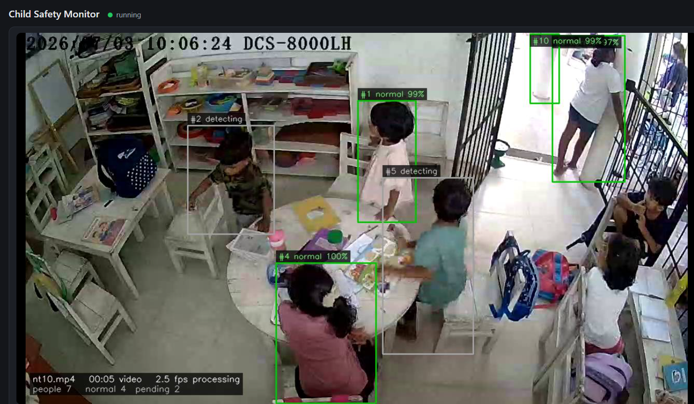
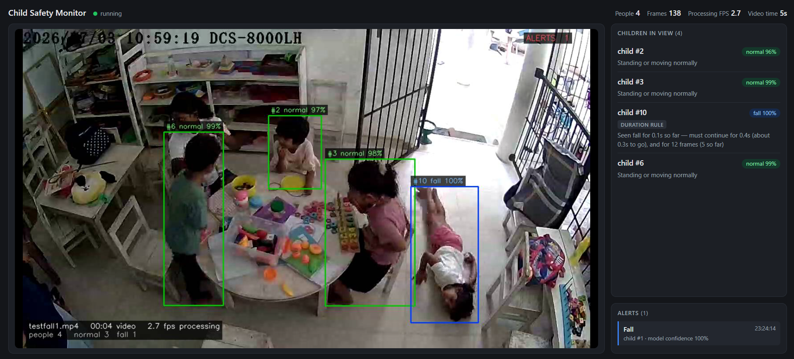
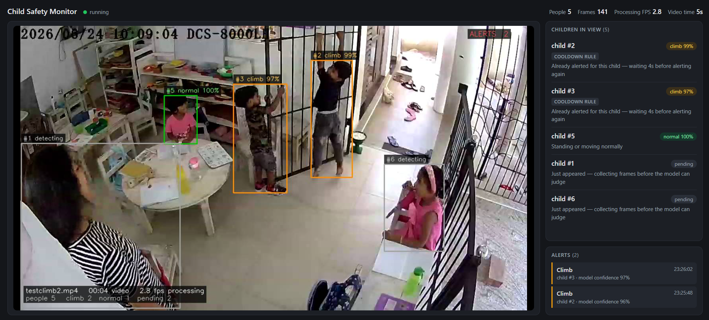

# Child Safety Monitoring System

A computer vision system that watches CCTV footage of a childcare classroom and raises an alert when a child **falls** or **climbs** furniture.

This is my Final year research project for the **BSc (Hons) in Computer Science** at **NSBM Green University, Sri Lanka** supervised by **Mr. Gayan Perera**.

**Author:** Jayani Adikari

| | |
|---|---|
| **Dataset** | Recorded and annotated by hand in a working childcare classroom, no public datasets |
| **Pipeline** | YOLO11n → ByteTrack → RTMPose → 1D CNN-LSTM → deterministic alert rules |
| **Development** | Two phases. The first was built on public datasets and failed on real footage; the second was rebuilt around my own dataset and produced a working system |

---

### Research problem

In childcare classrooms, a few teachers supervise many young children who move freely around the room. Falls and climbing on furniture happen quickly and a teacher looking elsewhere can easily miss them. CCTV cameras are often already installed but nobody watches the feed continuously, so it records incidents without helping to prevent them.

Automated activity recognition could fill that gap, but existing work doesn't transfer to this setting:

- Most fall-detection models are trained on **adults**, while children have different body proportions and move differently.
- Classroom cameras are mounted **high and angled down** and popular pose estimators produce broken skeletons from that angle.
- In a real classroom, dangerous events are **rare** compared with normal activity so a model that looks accurate on balanced data raises constant false alarms in practice.

**Research question:** can a computer vision system reliably detect falls and climbing by young children in real classroom CCTV footage with a false-alarm rate low enough to be useful to a supervising teacher?

### Solution

A pipeline that works only from **skeleton motion** built and evaluated on footage from the target environment.

- **Child-appropriate pose estimation.** RTMPose, chosen after MediaPipe failed on overhead classroom footage.
- **Training data from a real childcare classroom** instead of adult fall datasets.
- **Per-child temporal classification.** A 1D CNN-LSTM over 15-frame skeleton windows, normalised so it learns body movement rather than where a child is standing.
- **Deterministic verification rules** decide whether a prediction becomes an alert, so each alert can be explained and each rule's effect measured.
- **Privacy by design.** Decisions are made from skeleton keypoints not from images of the children.

---

## What I built

I carried out the research and built every part of this system myself — data collection, annotation, model training, the verification layer and the dashboard.

**I created the dataset.** No public dataset contains young children falling or climbing in a real childcare room, so I built one. I installed a ceiling-mounted IP camera in a working classroom, recorded ordinary activity, reviewed all of the footage myself and annotated **685 activity events** by hand. Each annotation records the exact child, the activity and the start and end time, not just the frame, because several children are usually in view and only one is falling. Identifying which track ID belongs to which child meant stepping through clips with a purpose-built viewer (`track_viewer.py`) before any annotation could be written.

**I rebuilt the system after the first version failed.** Phase 1 reached 91% validation accuracy on public adult datasets and produced nothing usable on real classroom footage. Rather than tuning it, I diagnosed why: MediaPipe lost the lower body at the overhead camera angle and the hip-to-ankle relationship it discarded is exactly what separates a fall from a climb. I replaced the pose estimator, replaced the training data and redesigned the classifier. That diagnosis is the most useful result in the project.

**I measured every design decision rather than guessing.** The person-relative normalisation was validated as a controlled experiment — same data, same test set, one variable changed — and raised macro F1 from 0.346 to 0.430, roughly halving false alarms on ordinary activity. Every alert threshold comes from a sweep over the annotated data, measuring what each setting costs in genuine events against what it removes in false alarms. Every rule can be switched off independently, so its individual contribution is measurable rather than assumed.

**I tested the parts that fail silently.** The verification layer has **53 assertions across 46 test functions**. Two of the defects they caught produced no error message at all, a disabled rule that was still running and a counter that overstated how often the rules were acting. Without the tests, the ablation figures would have been wrong with nothing to indicate it.

**I built the full system, not just the model.** Detection, tracking, pose estimation, normalisation, classification, alert verification, zone monitoring, the alarm, the JSON log and a live web dashboard are all connected into one working pipeline that runs end to end on an ordinary CPU.

---

## What it does

The system takes a live camera or a video file, finds and tracks every person in the frame, estimates each person's skeleton and classifies what each one is doing from how their skeleton moves over time.

The classifier only proposes an event. A set of deterministic, individually switchable rules decides whether it becomes an alert. Alerts are delivered as an audible alarm, an on-screen overlay, a web dashboard and a JSON log.

---

## Example predictions

Screenshots of the system running on test footage. Each box shows the child's track ID, the predicted class and the model's confidence. **ALERT** appears once a prediction has passed every verification rule.

| Normal | Fall | Climb |
|---|---|---|
|  |  |  |

---

## How it works

Each frame passes through five stages. Every person in the frame is tracked separately, so several children can be classified at the same time.

**Detection and tracking.** YOLO11n finds every person in the frame, and ByteTrack assigns each one an ID that stays with them while they remain in view. That ID is what lets the system say *which* child is falling rather than only that something happened in the room.

**Pose estimation.** RTMPose extracts 17 body keypoints for each tracked child, each with a confidence score. Nothing downstream of this stage sees image data, so the rest of the pipeline works entirely from coordinates.

**Normalisation.** Keypoints arrive as screen positions, so the same movement produces different numbers depending on where a child stands. Each frame is re-centred on the mid-hip and scaled by torso length, giving 51 values per child per frame: 34 coordinates and 17 confidence scores.

**Classification.** Each child has their own rolling buffer of the last 15 frames. A 1D CNN-LSTM labels the window as normal, fall or climb with a confidence. The convolutional layers pick up relationships between joints; the recurrent layers track how those relationships change over the window.

**Verification and alerting.** Every prediction passes through four deterministic rules before an alert is raised. If it clears all four, the system sounds an alarm, draws the alert on screen, updates the dashboard and writes a JSON log entry.

| Stage | Component | Notes |
|---|---|---|
| Detection and tracking | [person_detector.py](montessori-safety/src/detection/person_detector.py) | YOLO11n with COCO weights (no fine-tuning) and ByteTrack IDs |
| Pose | [rtmpose_extractor.py](montessori-safety/src/pose/rtmpose_extractor.py) | RTMPose `lightweight` via rtmlib on ONNX Runtime, CPU or CUDA |
| Normalisation | [normalize_sequences.py](montessori-safety/normalize_sequences.py) | Removes screen position and camera distance so the model learns body motion. Undetected joints are zeroed. |
| Classifier | [train_cnn_lstm.py](montessori-safety/src/classification/train_cnn_lstm.py), [activity_classifier.py](montessori-safety/src/classification/activity_classifier.py) | `Conv1d(51→64→128) → LSTM(128, 2 layers) → FC(128→64→3)`. 307,587 parameters, one buffer per track. |
| Verification | [alert_verifier.py](montessori-safety/src/verification/alert_verifier.py) | Four rules in sequence, see [From prediction to alert](#from-prediction-to-alert) |
| Zones | [zone_monitor.py](montessori-safety/src/zones/zone_monitor.py) | A box's bottom-centre point must stay inside a polygon for 5 frames |
| Alerts | [alert_system.py](montessori-safety/src/alerts/alert_system.py) | Alarm of about 3.3 s (Windows `winsound`), per-child cooldown, alert log |
| Dashboard | [app.py](montessori-safety/src/dashboard/app.py) | Flask. MJPEG video stream plus a once-a-second state poll. |

---

## From prediction to alert

This is the part of the system I consider the real contribution. A classifier that flags 17.7% of ordinary play as dangerous would be switched off within a day, however good its recall. Four deterministic checks sit between the classifier and the alarm.

Fall and climb predictions pass the checks in order. The first one that fails rejects the prediction, and the verifier counts how many predictions each rule rejected — which gives a full ablation table from a single run.

| # | Rule | Fall | Climb | Why |
|---|---|---|---|---|
| 1 | Confidence threshold | ≥ 0.70 | ≥ 0.90 | At 0.70, climb produced about three times the false alarms of fall. Fall is kept lower because a missed fall is the worst outcome. |
| 2 | Duration | 12 frames **and** 0.4 s | 30 frames **and** 1.0 s | Set from the 201 annotated fall and climb events. 22% of falls last under 1 s, so falls get a short requirement. Climbs are sustained (median 4.4 s). Gaps of up to 0.4 s in detection are tolerated. |
| 3 | Geometry veto | rejected if peak torso tilt over the last 15 frames < 8° | rejected if hip sits < 0.30 torso-lengths above feet | Rejects only predictions the pose clearly contradicts, and never rejects when it can't measure. Tuned on the **training** split so the test set stays clean. |
| 4 | Cooldown | 4 s per child per activity | same | Long enough that alarms don't overlap, short enough that a child still on the floor alarms again |

Every threshold above was chosen by measuring a trade-off, not by inspection. The fall geometry veto, for example, discards 2.7% of genuine falls while removing 14.5% of ordinary activity — an exchange of more than five to one.

On test footage, **800 model predictions produced 4 alerts** once all four rules were applied.

Time is measured in **video time** (frame index ÷ fps), not wall-clock time. Recorded clips process slower than real time on a CPU, and duration rules would never be satisfied otherwise.

By default the geometric rules only veto (`--rules-mode veto`). They can also act as a second detector (`detector` or `both`), but then the same rules end up checking their own detections, so `veto` is the default.

Zone alerts skip the verifier and use the zone monitor's own 5-frame buffer.

---

## Data

All training and test data was recorded in the target childcare environment. Nothing in it comes from public adult fall datasets.

| | Normal | Fall | Climb |
|---|---|---|---|
| Annotated events, train split | 434 | 85 | 97 |
| Annotated events, test split | 50 | 9 | 10 |
| Training windows (after capping normal at 5,000) | 5,000 | 583 | 1,710 |
| Test windows | 5,995 | 64 | 194 |

- 685 annotated events across 590 video files, in [ground_truth.csv](montessori-safety/data/ground_truth.csv). Each row gives the video, start and end time, activity, the track ID of the child doing it, and the split.
- Train and test are split **by video**, so no clip contributes windows to both sides.
- Windows are 15 frames long with a stride of 8.
- Class imbalance is handled by capping normal windows at 5,000 and using class-weighted cross-entropy.

The class ratio is roughly 148 normal windows for every fall. That isn't a flaw in the recording — it's what a childcare room is like, and the test split is deliberately left unbalanced so the false alarm behaviour stays visible.

Raw video and extracted `.npy` sequences are **not** in this repository (see [Ethics and data](#ethics-and-data)).

## Why this design

The project went through two phases and the first one failing is why the second one works.

**Phase 1** used MediaPipe for pose estimation and a plain LSTM classifier trained on 21,681 sequences from public adult fall-detection datasets. It reached 91.01% validation accuracy on that data and produced nothing usable on real childcare footage. Five failures showed up on deployment video: broken skeletons with the legs missing, a stationary person classified as fighting at full confidence a one-second classification delay against falls that complete in under a second, track identities lost behind furniture, and training data that contained no children at all.

Rather than tune around those symptoms, I traced them to two root causes a pose estimator applied outside the conditions it was designed for and training data that didn't match the deployment population.

**Phase 2** the system in this repository was rebuilt around them:

- **RTMPose replaced MediaPipe**, selected by testing both on footage from the actual deployment camera before committing to either. It returns 16 or 17 of 17 keypoints in exactly the conditions where MediaPipe failed.
- **Training data came from the target environment** instead of adult datasets.
- **Person-relative normalisation**, so the model learns body motion rather than screen position. Validated as a controlled experiment (see [Results](#results)).
- **A 1D CNN-LSTM replaced the plain LSTM.** The convolutions model relationships between joints, and the LSTM models how those relationships change over time.
- **Deterministic rules make the alert decision.** Every rule is explainable, separately switchable and measurable.
- **The scope was narrowed.** Fight detection contributed the system's most damaging failure mode while producing no reliable detection and was dropped.

The Phase 1 code isn't included in this repository.

---

## Limitations

Stated plainly, because a safety system should be judged on what it can't do:

- **Low precision on dangerous classes.** Per window, only about 1 in 10 fall predictions and 1 in 7 climb predictions are correct. The verification rules exist to bring that down to a usable alarm rate, and they do it by giving up some recall.
- **Falls are poorly calibrated.** The median model confidence on a real fall is only 0.36 so many real falls never reach the 0.70 threshold. This is why the rules rely on duration and geometry rather than confidence alone.
- **Few dangerous examples.** The test split has 64 fall windows from 9 events, so per-class figures have wide uncertainty.
- **Checkpoint selection used the held-out split**, and selected on accuracy rather than macro F1 — which biases towards the majority class and contradicts the evaluation methodology used everywhere else. Both are straightforward to correct and are listed as future work.
- **No fixed random seed**, so the exact training run can't be reproduced.
- **One environment.** Data comes from a single childcare setting and camera layout. Other rooms, angles and lighting are untested.
- **Tracking errors carry through.** If ByteTrack gives a child a new ID mid-event, the 15-frame buffer and duration rule start again from zero for that child.
- **About 1 FPS on CPU**, which suits recorded footage and demonstration rather than continuous live monitoring. All three models support GPU acceleration without design changes.
- **Assistive only.** The system supports a supervising adult and isn't validated for unsupervised use.

---

## Ethics and data

Video was recorded in a real childcare environment with ethics approval and written parental consent for every child.

- The classifier and rules work only from skeleton keypoints, never from raw pixels. No image data passes beyond the extraction stage.
- Raw footage is held on an encrypted local drive and is never committed to this repository. Video files, extracted sequences and model weights are all excluded by `.gitignore`.
- The pipeline's annotated output video is written locally for evaluation only and can be turned off with `--no-save`.
- Figures in the write-up use skeleton overlays only, and no identifiable faces appear.

The dataset can't be released for the same reason, which does limit reproducibility. The method is documented here in enough detail to be reimplemented on comparable footage.

---

## Acknowledgements

Supervised by Mr. Gayan Perera, Faculty of Computing, NSBM Green University.

Built on [Ultralytics YOLO](https://github.com/ultralytics/ultralytics), [ByteTrack](https://github.com/ifzhang/ByteTrack), [rtmlib](https://github.com/Tau-J/rtmlib), [RTMPose](https://arxiv.org/abs/2303.07399) and [PyTorch](https://pytorch.org/).
